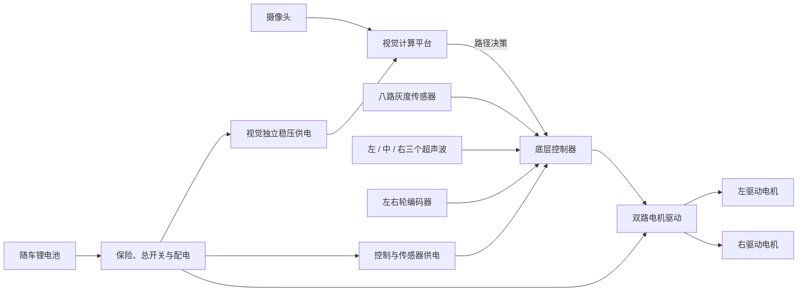

# 重走古丝路 · 自动循迹避障小车

> 工程创新训练课程项目：设计并制作一辆能够自动循迹、识别障碍并自主完成赛道任务的智能小车。

## 项目简介

本项目采用“两阶段迭代”的开发思路：先完成可靠的基础循迹与避障，再加入视觉识别和路径选择能力。

- **基础方案**：以八路灰度传感器和三个超声波传感器为主要感知手段，实现稳定循迹、近距离避障和终点停车。
- **进阶方案**：在基础方案上增加摄像头与视觉计算平台，用于识别赛道结构、岔路或快捷路线，并将决策发送给底层控制器执行。

两个方案共用同一套车体、动力、底层控制与安全机制，视觉系统属于后续扩展，不替代灰度循迹和超声波避障。

## 设计目标

- 全程自动运行，不依赖遥控或人工干预。
- 沿黑色赛道稳定行驶，并在偏离时主动修正。
- 识别并绕过赛道中的静态障碍物。
- 通过终点后及时停车。
- 保持结构轻量、重心合理且便于拆装维护。
- 为视觉识别、路径规划和自制扩展板预留升级空间。
- 整车尺寸不超过 `250 mm × 200 mm × 200 mm`。
- 整车电子元器件预算控制在 `1000 元`以内。

## 总体结构

车辆采用双层三轮结构：

- 两个带编码器的驱动电机；
- 两个橡胶驱动轮；
- 一个牛眼轮或小型万向轮作为支撑轮；
- 下层安装动力、电池和驱动部分；
- 上层安装控制器以及后续的视觉计算平台；
- 前部安装八路灰度传感器和左、中、右三个超声波传感器。

## 两阶段方案

### 1. 基础方案：循迹与避障

基础方案的目标是先让小车稳定完成赛道任务。

主要组成：

- 一个底层控制器；
- 八路灰度传感器；
- 左、中、右三个固定超声波传感器；
- 两个带编码器的驱动电机；
- 双路电机驱动；
- 两个驱动轮和一个牛眼轮；
- 一套随车锂电池及稳压、开关和保护电路。

主要功能：

- 根据八路灰度数据进行循迹和方向修正；
- 根据编码器反馈控制左右轮速度；
- 根据三个超声波的距离信息进行减速、停车和绕障；
- 通过终点后主动制动停车；
- 在传感器异常或控制失效时进入安全停车状态。

### 2. 进阶方案：视觉识别与路径选择

进阶方案保留基础方案的全部硬件和功能，并增加：

- 一个视觉计算平台；
- 一个前视摄像头；
- 独立稳定的视觉供电支路；
- 视觉计算平台与底层控制器之间的通信连接。

主要功能：

- 识别赛道、岔路和可选路线；
- 在存在多条路线时选择更短或更快的行驶路径；
- 向底层控制器发送前进、转向、减速和停车等决策；
- 在视觉暂时失效时，仍由灰度和超声波维持基础安全能力。

## 系统架构

基础方案不安装图中的摄像头和视觉计算平台，其余部分保持一致。

## 各感知模块的分工

| 模块 | 主要作用 |
| --- | --- |
| 八路灰度传感器 | 精确检测黑线位置，完成基础循迹和偏差修正 |
| 三个超声波传感器 | 检测车辆左前、正前和右前方的近距离障碍物 |
| 左右轮编码器 | 测量轮速，为速度闭环和直线修正提供反馈 |
| 摄像头与视觉计算平台 | 识别更远处的赛道结构、岔路和可选路线 |

## 控制分层

- **底层控制器**：负责传感器读取、电机控制、速度闭环、循迹、避障和紧急停车。
- **视觉计算平台**：负责图像处理、赛道理解和高层路径决策。
- **通信机制**：视觉平台只发送简洁的决策指令；如果通信中断，底层控制器应自动减速或停车。

这种分层方式可以保证视觉程序尚未完成时，车辆仍能依靠基础方案独立运行。

## 电源设计

整车只使用一块随车电池，经过保险和总开关后分为两个主要支路：

1. 动力与底层控制支路，为电机驱动、控制器和传感器供电；
2. 视觉支路，通过独立稳压模块为视觉计算平台和摄像头供电。

所有模块保持共地。视觉支路与电机支路分开，可以降低电机启动和换向时的电压波动对视觉系统的影响。

## 开发路线

- [ ] 完成采购清单与接口核对
- [ ] 搭建电机、驱动和编码器测试平台
- [ ] 完成八路灰度循迹
- [ ] 完成三个超声波的顺序测距与基础避障
- [ ] 完成双层自制车架设计和加工
- [ ] 完成基础方案整车联调
- [ ] 接入摄像头与视觉计算平台
- [ ] 完成视觉识别和路径决策
- [ ] 完成整车速度、制动距离和稳定性调试
- [ ] 整理BOM、设计文件、加工记录和比赛材料

## 项目约束

- 小车必须全自动运行。
- 只能使用一个安装在车内、随车运行的电源。
- 主体车架必须由团队自行设计和加工，不能直接使用完整成品车架。
- 不得在赛道或赛道周围添加辅助标记、补光或遮光设施。
- 可以在小车本体上安装传感器遮光或补光结构。
- 调试时需要兼顾循迹稳定性、避障成功率、完赛时间和终点停车位置。

更完整的比赛规则与评分说明见：[大作业要求总结](大作业要求/大作业要求总结.md)。

## 当前状态

项目目前处于方案确定与首批硬件采购阶段。基础方案优先落地，进阶视觉方案将在底盘、循迹和避障功能稳定后接入。

## 项目资料

后续将逐步补充：

- 硬件采购清单与BOM；
- 接线图与接口说明；
- 底层控制程序；
- 视觉识别程序；
- 车架设计文件；
- 调试记录与比赛结果。

---

本仓库用于课程项目开发、资料整理和团队协作，内容将随项目进度持续更新。